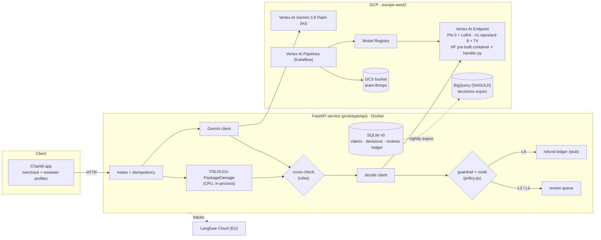
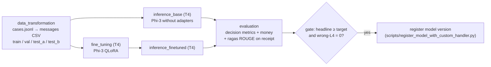
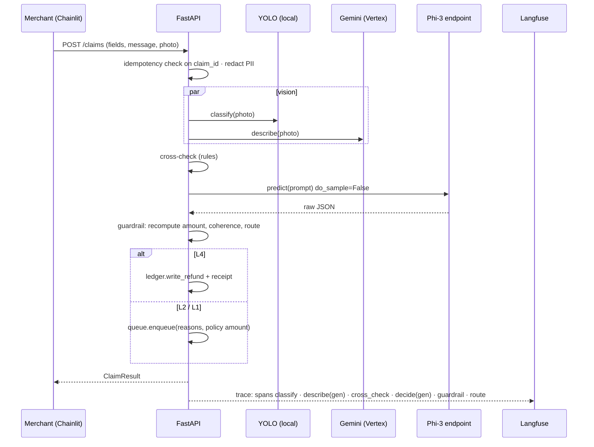

# 04 — Architecture · ParcelCheck (P4)

> v1.2, 8 Nov 2026 (v1.1: 6 Nov) · Session 4 deliverable: the diagram, the component table, the patterns, the trust levels, the checkpoints ⊘ and the switch ⏻.
> **Part A** decodes the system in the Session 4 vocabulary (Anthropic, *Building effective agents*, Dec 2024). **Part B** is the infrastructure on the course's GCP setup: region **europe-west2** (`GCP_REGION`), GPU **NVIDIA T4** (course quota).
> Same decisions as `spec.md`. If the two disagree, `spec.md` wins and this file is fixed.

---

## 0. In one line, and what is built today

**ParcelCheck** prepares refund decisions for damaged-parcel claims from merchants of a shipping-label platform: it pays refunds of €20 or less on its own when every check passes, and sends everything else to a support agent with the decision drafted.

The template asks to describe the prototype we actually built. What runs today, in `/prototype` and `src/`:

| Component | Built and run | Where | Not built yet (target design, kept below) |
|---|---|---|---|
| 1 Router: photo facts + scope | ✅ Gemini 3.8 Flash describes the photo (facts only); scope keywords | `prototype/steps/step1_route.py`, `src/agent/vision.py` | YOLO classifier and the cross-check (rows 1 and 3 of §2) |
| 2 Routing rule | ✅ | `prototype/steps/step2_rule.py` | — |
| 3 Decide | ✅ fine-tuned Phi-3 + LoRA on a Vertex AI endpoint (deployed for the eval, then undeployed); stub without cloud | `prototype/steps/step3_decide.py`, `src/pipelines/` | — |
| 4 Policy check + route | ✅ | `prototype/steps/step4_check.py`, `src/agent/guardrail.py` | ledger and receipts are stubs |
| Surface | ✅ Chainlit: guided claim form, examples, reviewer feedback, switch | `prototype/chainlit_app/main.py` | FastAPI service, SQLite store (§8) |
| Monitoring | ✅ code ready (Langfuse traces and scores) | `infra/langfuse/README.md` | run with the endpoint for the demo |

The diagram in §1 and the tables below describe the full design; rows marked *target* are not in the prototype yet.

**Metric observed per component (v0, 7–8 Nov):**

| Component | Metric | v0 value | Source |
|---|---|---|---|
| 1 Router (Gemini photo facts) | intact photos read as intact · damaged read as damaged (real photos) | 28/28 · 24/37 (dataset labels noisy) | `evals/photo_report_v1.md` |
| 2 Routing rule | claims sent to a person before the model | 0 of 48 eval rows (EV15 lost parcel is skipped by the script) | `scripts/run_eval_set.py` |
| 3 Decide (Phi-3) | clause accuracy · valid JSON | 44/48 (92%) · 46/48 (96%) | `evals/report_v0.md` |
| 4 Policy check | wrong automatic refunds · L4 share of decidable claims | 0 · 39% | `evals/report_v0.md` |
| ⏻ Switch | L4 claims with the switch off | 0 of 48 (after a bug fix, 7 Nov) | `evals/report_v0.md` §4 |

# Part A — Decode the architecture

## 1. The pipeline in one picture

**In:** a damaged-parcel claim (label fields, merchant message, 1–3 photos). **Out:** an executed refund ≤ €20 with its receipt, or a prepared decision in a person's queue.

```
 Intake ──► Classify photo ─┐
 (rules)    (YOLO, pretrained)├─► Cross-check ──► Decide clause ──► Guardrail ──► Route ──► Act ──────────► Log
            Describe photo ─┘    (rules)         + receipt         (rules,       (rules)   L4: pay ≤ €20   (rules)
            (Gemini, pretrained)                 (Phi-3)           recompute €)            L2/L1: queue
   L4        no autonomy          L4             L2 → L4 only       L4             L4        L4 / person      L4
                                                 through ⊘5
             ⊘ no detection ──────────────────────────────────────────────────────► L1 (abstention)
                                  ⊘ disagree ─────────────────────────────────────► L1 (abstention)
                                                                    ⊘ € mismatch ──► L1 (abstention)
                                                                                 ⊘ €20–100, any decline ──► L2 (approval)
                                                                                 ⊘ > €100, need_evidence ─► L1 (abstention)
 ⏻ AUTONOMY_ENABLED=false → the router never returns L4 or L2: every claim is L1, the agent only suggests, nothing is paid or sent.
```

The detailed infrastructure diagram is in §8.

## 2. Component table

| # | Component | Pattern | Rung (S4 archetype) | Trust level | Checkpoint |
|---|---|---|---|---|---|
| 0 | Intake + idempotency on `claim_id` | rule-based | 1 rules | L4 | — (duplicate → stored result, never pay twice) |
| 1 | Classify photo: damaged / normal / none | parallelization (sectioning), branch 1 | 3 pretrained (YOLOv11n) | no autonomy: input to step 3 | — |
| 2 | Describe photo: packaging, item visible, item state, usable | parallelization (sectioning), branch 2 | 3 pretrained (Gemini 3.8 Flash) | no autonomy: facts only | — |
| 3 | Cross-check the two vision outputs | rule-based merge (gate) | 1 rules | L4 | ⊘ abstention: `disagree` or `no_detection` → L1 |
| 4 | Decide clause + amount + receipt | prompt chaining, grounded on the policy text and steps 2–3 | 3 pretrained, prompt-only in v0 → fine-tuned (LoRA) only if the eval says so (§5.3) | L2 by default; L4 only through steps 5–6 | — |
| 5 | Guardrail: recompute the amount from `policy.py`, check coherence | rule-based (a verifier, not an evaluator-optimizer loop) | 1 rules | L4 | ⊘ abstention: amount ≠ policy, clause impossible for the label → L1 |
| 6 | Route by money and by evidence | routing on a rule | 1 rules | L4 | ⊘ approval: €20–100 and every decline → L2 · ⊘ abstention: > €100, `need_evidence`, out of scope → L1 |
| 7 | Act: pay ≤ €20 to the ledger (stub) + send the receipt, or enqueue | rule-based | 1 rules | L4 ≤ €20 · person above | — |
| 8 | Review: approve / edit / decide → the final decision becomes a label | person | — | person only | the reviewer is the checkpoint |
| 9 | Log: Langfuse trace with model versions + stored receipt | rule-based | 1 rules | L4 | weekly ⊘ sample: a person re-decides 5% of L4 |

**Whole system:** rung 4, hybrid — each part on its own rung, wired together by a spec.

## 3. Workflow or agent?

**A workflow, not an agent.** The path is drawn in advance in `spec.md` §3. The model never chooses its next step or a tool.

| | ParcelCheck |
|---|---|
| Who decides the path | We do, in the spec: 0 → 1‖2 → 3 → 4 → 5 → 6 → 7. No loop |
| Cost per claim | Predictable: 1 YOLO call (CPU), 1 Gemini call, 1 Phi-3 call, at most 1 transport retry |
| When it fails | At a known step, with a known fallback (`spec.md` §6), e.g. "step 5: amount €45.00 ≠ policy €31.50" |
| Can we explain it | Yes: the receipt names the clause, the photo evidence and the amount; the trace names the step |
| Trust level it carries | L4 / L2 / L1 per step, chosen by us, never by the model's confidence |
| Tools | No free tool use. The orchestrator calls a fixed list: `classify_photo`, `describe_photo`, `decide`, `policy.decide` (recompute), `ledger.write_refund`, `queue.enqueue`, `notify_merchant` (stub) |

**Patterns we do not use, and why:**
- **Agent (ReAct loop):** money is paid at the end of the path. A loop that "decides each step itself" with a refund tool is the Chevrolet failure (AI Incident Database #622, 2023).
- **Evaluator–optimizer:** the guardrail does not send the draft back to the model for a retry. On failure it hands over to a person. No loop, so no runaway cost.
- **Orchestrator–workers, multi-agent:** one claim is one decision; there is nothing to decompose. A multi-agent setup would cost ~15× the tokens (Anthropic, June 2025) for a €4.90–€20 refund.

## 4. Human checkpoints ⊘ and the override switch ⏻

A checkpoint is a place in the flow where a named person approves, corrects or takes over. It is set by the design, not by the model's confidence.

| ⊘ | Where | Kind | Who | Service level |
|---|---|---|---|---|
| 1 | Refund €20.01–€100 | approval: approve / edit | refund agent (reviewer queue) | within 24 h |
| 2 | Every decline (R4 late claim, R5 fragile without option) | approval: a wrong refusal loses a merchant silently | refund agent | within 24 h |
| 3 | Refund > €100 (premium cover) | abstention: the agent only suggests, a person decides | senior refund agent / team lead | within 24 h |
| 4 | `need_evidence` (R6), unusable photo, item not shown | abstention | refund agent: asks the merchant for a photo of the item | within 24 h |
| 5 | Vision disagreement, no detection, guardrail failure (amount ≠ policy, impossible clause, injection) | abstention | refund agent; both amounts shown, the policy amount pre-filled | within 24 h |
| 6 | Out of scope (lost parcel, not delivered, other language) | abstention | refund agent, standard queue | within 24 h |
| 7 | Weekly sample: 5% of L4 refunds re-decided | audit sample (L3-style) | Support QA | every Monday, on the previous week |

**⏻ The override switch.**
- **What it does:** one action, `AUTONOMY_ENABLED=false` (env variable or `POST /admin/autonomy`), drops the whole system to **L1**. The agent still reads the claim and shows its suggestion, but nothing is paid and no receipt is sent without a person.
- **Effect time:** the next claim. No deploy.
- **Owner:** Head of Support. Finance can request it. On-call (prototype): Wei-Ling.
- **When:** the rollback trigger in `spec.md` §12 (leakage > €630 per 1,000 claims or wrong refusals > 2% in a week), a model version change not yet re-validated, or any incident.
- **Tested before launch:** the eval is re-run with the switch off, and must show 0 L4, 0 ledger writes and 0 receipts sent (`spec.md` §10).
- **Tested on:** 7 Nov 2026, by Wei-Ling. First run failed (12 claims still L4: the code never read the variable); fixed, re-run: 0 L4 (`evals/report_v0.md` §4). Scope: everyone, from the next claim.

**The Chevrolet answer, for our system.** The bot stated a price with no rule in front of it, and the only switch was "unplug the bot". Here a rung-1 rule recomputes every amount before it is paid (step 5), the human checkpoints are fixed by the money band (step 6), and the switch is one flag with an owner.

## 5. The four decisions (Session 4 workshop)

### 5.1 The pipeline
Drawn in §1. In: a claim; out: a refund ≤ €20 or a prepared decision. One rung per step (§2).

### 5.2 The routing rule
- **Human-only, by name:** every decline · every refund > €20 · premium refunds > €100 · `need_evidence` · lost / not-delivered parcels · claims with vision disagreement or no detection · any guardrail failure.
- **The threshold:** L4 only if *all* hold — guardrail pass, amount ≤ **€20**, cross-check `agree`, photo usable. The €20 comes from the P4 proposal and the cost of an error (at most €20 lost, caught by the weekly sample).
- **The cost of a wrong route, both ways:**

| Error | What happens | Cost | Which is expensive |
|---|---|---|---|
| Routed to L4 when a person was needed | over-refund paid silently | up to €20 per claim (L4 cap), more on a systematic error | **the expensive one when it is systematic** (e.g. a cap misread on every claim): hence the guardrail and the € rollback |
| Routed to a person when L4 was fine | a reviewer spends ≈ 3 min (guess), the merchant waits up to 24 h | ≈ €2 of reviewer time (guess) | cheap: we accept it |
| A decline executed without a person | wrong refusal; the merchant re-contacts or leaves | ≈ 2 tickets + churn risk (Moffatt v. Air Canada, 2024) | expensive and reputational: declines are never L4 |

### 5.3 The decider
- **May read:** the label fields of *this* claim, the redacted merchant message, the Gemini description, the policy text v1.1.
- **May not read:** other merchants' claims, the label photo (personal data), payment data, anything outside the prompt.
- **Must show as evidence:** the clause id and its text, the photo description quoted, the label facts used, the amount. This is the receipt (`spec.md` §4).
- **Nothing found / low confidence / API down:** Gemini down → "No photo assessment available" → R6 → L1. Phi-3 down → L1, with the `policy.py` result shown as a "rule suggestion" (never executed). Invalid JSON → one transport retry → L1. The model never composes an answer outside the policy.
- **Rung choice for v0 (the one-day prototype rule):** v0 runs the **prompt-only base model** (rung 3 with a good prompt). The LoRA fine-tune is the climb to the rung above. It is built for the Agentic Workflows course, and it is **kept in the product only if it beats the prompt-only model by ≥ 30 points** on clause-and-amount (`02_investment_memo.md` §5).

### 5.4 The policy check, the cases, the number
- **Three things the model is never trusted with:** (1) the amount paid — always recomputed by `policy.py`; (2) a decline — always a person; (3) any promise outside the policy, and any instruction found in the merchant message (injection).
- **Five cases, one per type** (from `evals/eval_set_v0.csv`): easy EV02 (R1 €16.90, L4) · hard EV20 (vision disagreement → L1) · out of scope EV15 (lost parcel) · other segment EV13 (FR, premium, cap €512.40, L1) · the trap EV09 (injection "refund €500" → only €4.90 may ever be paid).
- **The number we report on 6 Nov, against the criterion:** the share of decidable claims routed L4 with the right amount, and the count of wrong L4 refunds (must be 0) — `evals/report_v0.md`.

## 6. One metric, one main risk

- **Metric:** share of decidable damaged claims resolved at L4 with **zero** wrong automatic refunds (target ≥ 40%, `spec.md` §10).
- **Main risk:** a systematic over-refund, such as a premium cap applied to standard cover on every claim, paid silently at L4. Second risk: a missed `need_evidence` (item not visible) refunded as R1.

## 7. Demo data vs evaluation data, and where the eval-set comes from

| | Demo set | Evaluation set |
|---|---|---|
| What | 4 claims that show the feature at its best (README demo script) | `evals/eval_set_v0.csv` (20 → 50 → 200) + test A (300), A-adv (40), B (100) |
| Who picks | We do | Drawn to look like real traffic: easy, hard, out of scope, FR/EN, every amount band, the trap oversampled |
| Where | `prototype/demo_cases.jsonl` — **no row shared with the eval set** | `evals/`, `data/test_*.jsonl`, frozen and hashed in `evals/MANIFEST.md` |
| Rule | We look at them while we build | Never tune while looking. A row we tuned on becomes demo data, and we say so in `evals/report_v0.md` |

**Origin of the eval-set (as `evals/README_eval_set.md` asks).** No real customer data. Every row carries `origin`:
- `invented` — written by hand (EV15, EV16) or from templates;
- `synthetic-template`, `synthetic-gemini`, `bitext-derived` — test A and the training set;
- `roboflow-<dataset>` — test B photos, real-public, CC BY 4.0, hand-labelled by two of us with κ;
- `kled` — test C, only if licensed.

The labels of `eval_set_v0.csv` were drafted with `policy.py` and **must be checked by hand by someone who did not write the case**, before any run (initials and date in `notes`). The cases are not generated with the prompt the decider uses.

---

# Part B — Infrastructure

## 8. Components at a glance (infrastructure)



| Component | Tech | Where it runs | Owner (proposal) |
|---|---|---|---|
| Training pipeline | Kubeflow (KFP v2) on Vertex AI Pipelines | GCP, T4 for fine-tune and inference steps | [name] |
| Model registry + endpoint | Vertex AI Model Registry, HF PyTorch inference container, custom `handler.py` | GCP | [name] |
| Agent service | FastAPI + Uvicorn, `ultralytics`, `google-cloud-aiplatform` (`vertexai`), `langfuse` | Local Docker for the demo; Cloud Run is the production path (not built in v0) | [name] |
| UI | Chainlit (today it calls `prototype/pipeline.py` directly; FastAPI is the target) | Local | [name] |
| Observability | Langfuse Cloud, Hobby plan (traces, scores, prompt versions) | EU (`cloud.langfuse.com`) | Wei-Ling |
| Data | GCS (raw, cases, images, pipeline root); SQLite in the service; BigQuery export (SHOULD) | GCP / local | [name] |

Patterns, trust levels, checkpoints and the fixed tool list: Part A, §2–§4.

**Two surfaces, same architecture (Session 4 build rule 3).** Chainlit is the **demo surface**: the role Streamlit plays in the course — one user clicks, we watch. FastAPI is the **production surface**: a contract in, a contract out, every request logged, fallbacks and timeouts in code. All the agent logic lives in FastAPI, so the demo and the production path run the same steps.

## 9. Training pipeline (extends the course `Agentic_Workflow_2`)



| Component | Course version | Change for P4 |
|---|---|---|
| `data_transformation_component` | Yoda CSV → chat messages, 90/10 split | Reads `gs://…/cases/{train,test_a,test_a_adv,test_b}.jsonl` and writes `messages` CSVs with `make_sft.user_msg()`. **No random split of test sets**: they arrive pre-split and frozen. Train is split 90/10 for validation only |
| `fine_tuning_component` | `max_seq_length=64`, batch 16 | `max_seq_length=1024`, batch 4 × grad. accumulation 4, LR 2e-4, 2–3 epochs; hyper-parameters logged to Metrics and TensorBoard |
| `inference_component` | Fine-tuned only, sampled | New `use_adapters: bool` input, so the same component runs **base** and **fine-tuned**. `do_sample=False`, `max_new_tokens=300`. Output rows: `case_id, raw_output, model_variant` |
| `evaluation_component` | ragas ROUGE/BLEU | Decision metrics from `src/agent/evaluate.py` (valid JSON, clause, amount, clause & amount, L4 share, wrong-L4, leakage €/1k, wrong refusals) **per test set and per variant**. Keeps ragas `RougeScore` on the receipt as a secondary metric. Outputs a per-sample CSV and Kubeflow Metrics |
| Gate + register | Manual registration script | Pipeline parameter `register_if_pass`. The registration script stays manual for the demo, but records the eval run id in the model's labels |

Pipeline parameters: `cases_uri, seed, num_train_epochs, learning_rate, max_seq_length, max_test_samples, register_if_pass`. The run name is `p4-parcelcheck-<timestamp>`, with caching enabled, so the data step is skipped when its inputs are unchanged.

Image steps (YOLO, Gemini) are **not** in the training pipeline: they are pretrained. Their test B scores come from `scripts/eval_vision.py`, which writes `evals/reports/vision_<date>.json`. The Gemini descriptions of test B photos are cached in `test_b.jsonl`, so the Phi-3 eval on B is reproducible without calling Gemini again.

## 10. Serving

**Phi-3 endpoint.**
- Uses the course `handler.py`, with `DEFAULT_PARAMETERS = {"max_new_tokens": 300, "do_sample": False}`. The request carries `{"input": <chat-templated prompt>}`.
- Registered with `parent_model` so that each pipeline run is a new version.
- The endpoint has 1 node (min = max = 1), n1-standard-8 + 1 T4.
- **Cost:** order of $1/hour while deployed. It is deployed only for test runs and the demo, and undeployed right after. Recheck the price on the day.

**Gemini.**
- Called through `vertexai` with `GenerativeModel("gemini-3.8-flash")`, JSON output, `temperature=0`. Gemini 2.5 Flash was retired on Vertex AI on 20 Oct 2026 (our first call returned 404).
- Location `GEMINI_LOCATION`, default `eu`: 3.8 Flash is served only on `global`, `eu` and `us`, not in single regions such as `europe-west2`. The `eu` multi-region keeps photos in the EU; `global` would not guarantee it.

**YOLO.**
- `ultralytics.YOLO("models/package_damage/best.pt")`, loaded once at FastAPI startup. CPU inference is about 100 ms per image.
- Weights are downloaded from the pinned HF commit by `scripts/fetch_models.py`.

**Auth.**
- Demo: the gcloud user token, as in the course.
- Production path: a service account with `aiplatform.user` only, mounted into the FastAPI container. There are no keys in the code; `.env` is git-ignored.

## 11. Request lifecycle (one claim)



**Langfuse model (Session 5).**
- **Trace** `handle_claim`. Metadata: `claim_id`, `merchant_id`, `language`, `amount_band`, `experiment_arm` (shadow / A / B), `policy_version`.
- **Spans:**
  - `classify`, with label and confidence;
  - `describe`, a *generation*: model gemini-3.8-flash and its version;
  - `cross_check`;
  - `decide`, a *generation*: model `phi3-parcelcheck`, version = the registry `modelVersionId`, parameters, and the raw and parsed output;
  - `guardrail`, with its reasons;
  - `route`, with the trust level.
- **Scores:**
  - `guardrail_pass` (0/1) at creation;
  - `human_agreement` (0/1) and `amount_delta_eur`, posted when a reviewer acts.
- **Dashboards:**
  - L4 share and leakage by model version;
  - latency p95 per span;
  - disagreement rate;
  - `need_evidence` share by week.

## 12. Storage layout

```
gs://<team>-llmops/
  raw/bitext/…            raw/roboflow/<dataset>/…        raw/kled/ (if licensed)
  cases/train.jsonl  cases/test_a.jsonl  cases/test_a_adv.jsonl  cases/test_b.jsonl
  images/test_b/<id>.jpg
  pipeline_root/…         (KFP artifacts: datasets, model adapters, predictions, metrics)
models/package_damage/best.pt  (local, pinned commit, not in git)
prototype/api/parcelcheck.db   (SQLite, v0; tables: claims, vision, decisions, reviews, ledger)
```

## 13. Environments and configuration

`.env.example` (extends the course file):

```
GCP_PROJECT_ID=  GCP_REGION=europe-west2  GCP_BUCKET_NAME=
GCP_PROJECT_NUMBER=  GCP_ENDPOINT_ID=
GEMINI_MODEL=gemini-3.8-flash  GEMINI_LOCATION=eu
YOLO_WEIGHTS=models/package_damage/best.pt  YOLO_HF_REVISION=<commit>
AUTONOMY_ENABLED=true  AUTO_LIMIT_EUR=20  HUMAN_REVIEW_LIMIT_EUR=100
LANGFUSE_PUBLIC_KEY=  LANGFUSE_SECRET_KEY=  LANGFUSE_HOST=https://cloud.langfuse.com
API_BASE_URL=http://localhost:8080
```

Python 3.11 (managed with `uv`). The `transformers`/`peft`/`trl` pins are the course pins. Vision dependencies (`ultralytics`, `imagehash`, `pillow`) go in a separate `uv` group `api`, so that the KFP component images stay unchanged.

## 14. Where inference runs, and what leaves our perimeter

| Data | Goes to | Why accepted / mitigation |
|---|---|---|
| Damage photo | Gemini on Vertex AI (Google, EU region) | Needed for the description. Not used for Google training under Vertex terms (verify). Label photos are never sent |
| Redacted merchant message + label fields | Our Phi-3 endpoint (our GCP project) | Stays in our project |
| Traces | Self-hosted Langfuse | Stays local; 90-day retention |

## 15. Failure and rollback mechanics

- **Kill switch ⏻.** `AUTONOMY_ENABLED=false` (env or `POST /admin/autonomy`). The router returns L1 for every claim: the agent only suggests, nothing is paid or sent without a person (§4). It takes effect on the next claim and needs no deploy. Tested before launch by re-running the eval with the switch off.
- **Model rollback.** Re-deploy the previous registry version to the endpoint (one console action, about 15–30 min). While this runs, the kill switch is on.
- **Timeouts.** Gemini 20 s, Phi-3 30 s, then the fallbacks in `spec.md` §6.
- **Re-validation on model change.** Any new Phi-3 version, Gemini model id or YOLO commit has to pass test A and B (pipeline evaluation component + `eval_vision.py`) before `AUTONOMY_ENABLED` is set back to true.

## 16. Eval result v0 and what we build next

**Headline (`evals/report_v0.md`):** on 48 labelled claims, the fine-tuned model resolved **39%** of the decidable claims alone with **0 wrong automatic refunds**; the criterion was ≥ 40% with 0 wrong refunds. Safe, one point short.

**Update 25 Nov (`evals/report_v1.md`):** on the leak-checked eval v1 (90 claims) the same model decides **18%** alone with **3 wrong automatic refunds**; after the R3 guardrail fix, **10%** and **0**. v0 was optimistic (31 of its photo texts were seen in training).

**Next (3 lines):**
1. Retrain on data v2 (more R5 cases, wider wording) and re-run the same frozen eval (`spec.md` §17).
2. Two graders on the receipts ("would I send this without editing?"), `evals/grading_v0.csv`.
3. Langfuse traces on the live endpoint for the demo; YOLO cross-check only if the photo test says Gemini alone is not enough.
