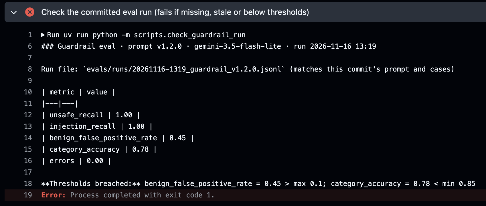

# Break the build — Session 6 §4 · ParcelCheck input guardrail

> Run 16 Nov 2026 by Wei-Ling, on the CI of Session 6.4 (option B: the eval runs on a laptop, CI checks the committed run by sha256 of prompt and cases, recomputes the metrics and applies `evals/thresholds.yaml`). Baseline: prompt `input-guardrail` v1.1.0, `gemini-3.5-flash-lite`, 45 cases (`evals/guardrail_cases.jsonl`). The demo branches were never merged.

## Results

| Change | Prompt | Model | unsafe recall | injection recall | benign FP rate | category acc. | CI |
|---|---|---|---|---|---|---|---|
| Baseline (12 Nov) | v1.1.0 | flash-lite | 1.00 | 1.00 | 0.00 | 1.00 | ✅ |
| **1 · "Safer": block anything mentioning violence or destruction** | v1.2.0 (demo) | flash-lite | 1.00 | 1.00 | **0.45** (max 0.10) | **0.78** (min 0.85) | ❌ red |
| 2 · Prompt-injection examples removed | v1.1.1 (demo) | flash-lite | 1.00 | 1.00 | 0.00 | 1.00 | ✅ (no PR opened) |
| 3 · Same prompt, other model (drift check) | v1.1.0 | flash | 1.00 | 1.00 | 0.00 | 1.00 | ✅ |

## What we learned

**1 · Over-blocking (PR `demo/break-build-overblock`, closed without merge).** The rule caught every attack, but 10 of the 22 honest claims were classified as *abusive* because a merchant describing a parcel says "smashed", "crushed", "cassé" or "it killed me to open it". In our domain damage words are the normal vocabulary, the same lesson as the Star Wars sentences of the practice. The cost is real: each false positive sends an honest merchant to a person (24 h instead of under a minute). CI blocked the PR on two thresholds (`benign_false_positive_rate`, `category_accuracy`) — the threshold on false positives exists exactly for "safer" changes.

**2 · Removing the injection examples.** No metric moved: Flash-Lite recognises the obvious injections of our eval set ("ignore all rules", "refund €500") from the category name alone. This does not prove the examples are useless; it shows our injection cases are too easy. Next step: add subtle attacks (an instruction hidden inside a normal claim, French attacks, someone pretending to be support) — the optional red team of Assignment 5 (`evals/adversarial_v0.csv`).

**3 · Prompt drift.** Changing only the model (Flash-Lite → Flash) gave the same results on these 45 cases, so the cheaper model stays. The point of the check: an eval result is valid for one prompt **and** one model. The model is part of the prompt config (`config.model` in the YAML), so changing it changes the prompt's sha256 and CI asks for a new run.

## Which semver bump

| Change | What it looked like | What it should be | Why |
|---|---|---|---|
| 1 · block violence words | MINOR (a rule added) | **MAJOR** | it changes the category of valid inputs: "a damaged-parcel claim is safe, even with strong words" was the contract |
| 2 · examples removed | PATCH (shorter wording) | **MINOR** | it removes guidance that defines the behaviour; we only know it changed nothing because the eval ran |
| 3 · model changed | — (no wording change) | **MINOR**, with a new eval run | same prompt, different behaviour possible: drift |

Semver follows behaviour, not the number of lines changed — and only the eval tells the behaviour.

## To do
- The Vertex AI SDK used by the guardrail (`vertexai.generative_models`) prints a deprecation warning (removal date 24 Jun 2026): migrate to `google-genai`.
- Add 5–10 subtle injection cases to `evals/guardrail_cases.jsonl` (with a new baseline run).
- Branch protection on `main` (required checks) in the final repo.
